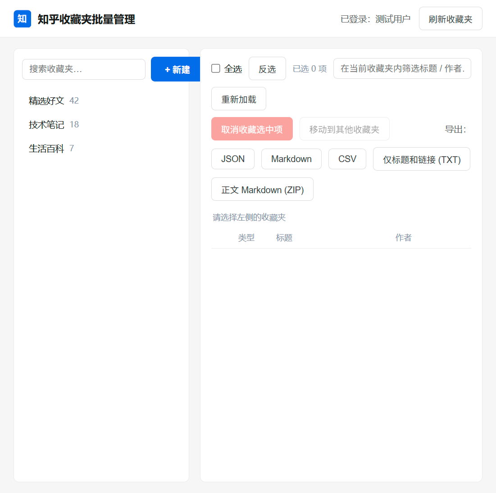
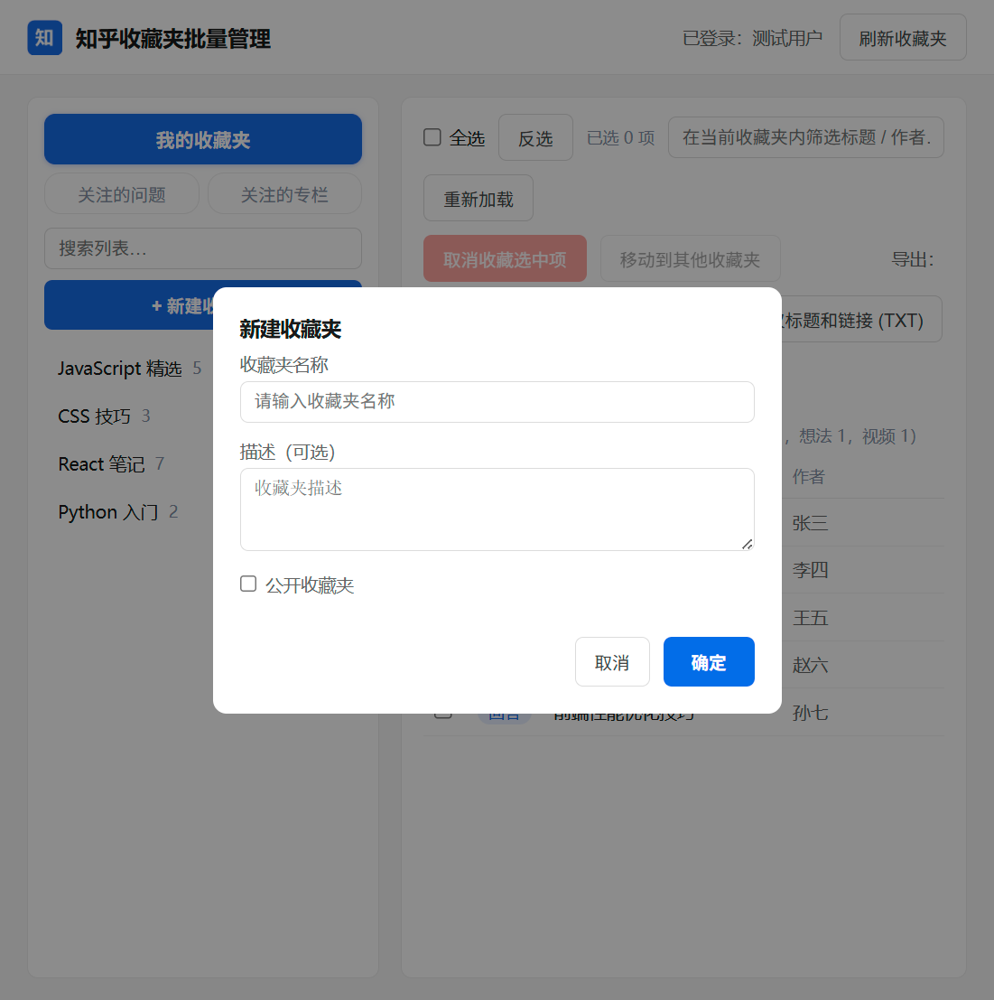
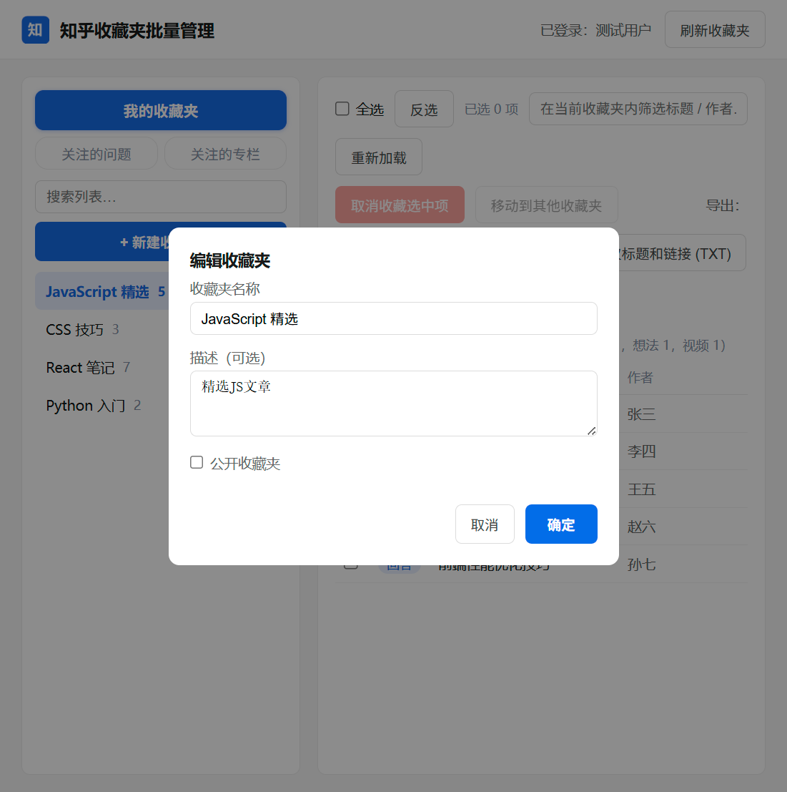
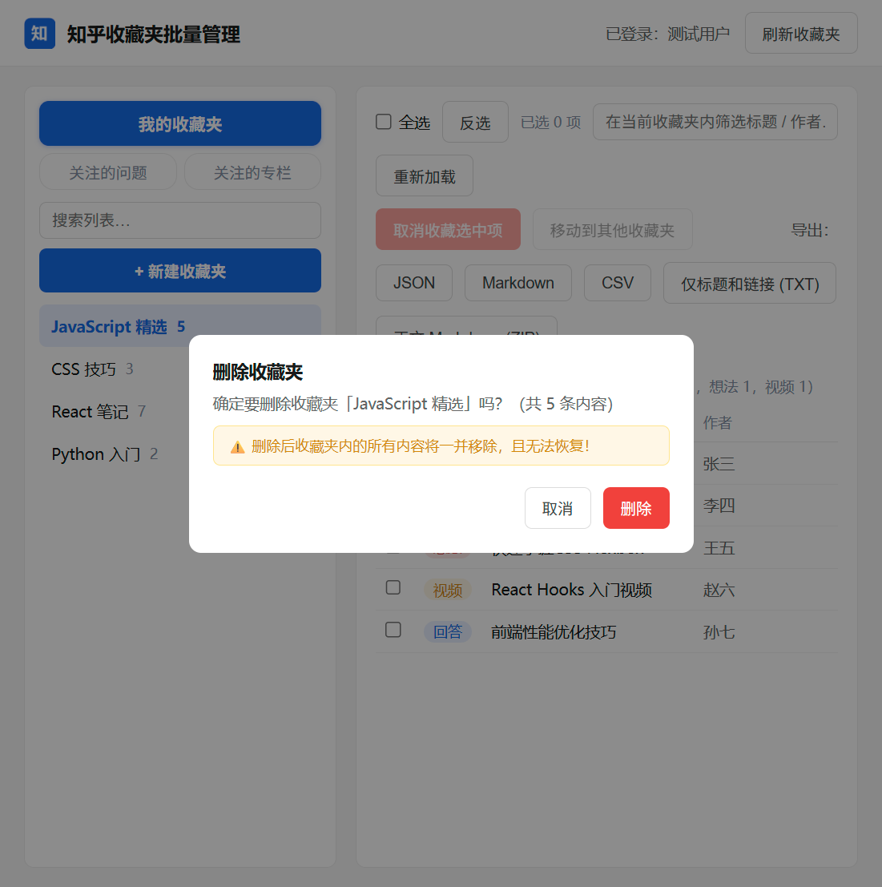
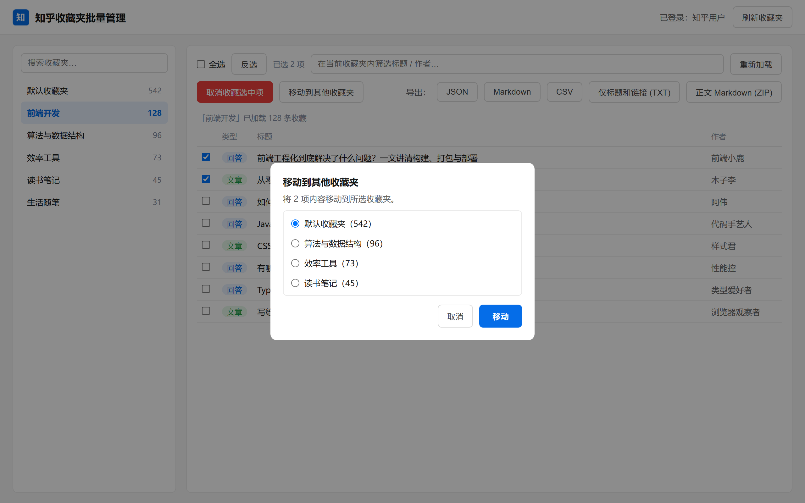
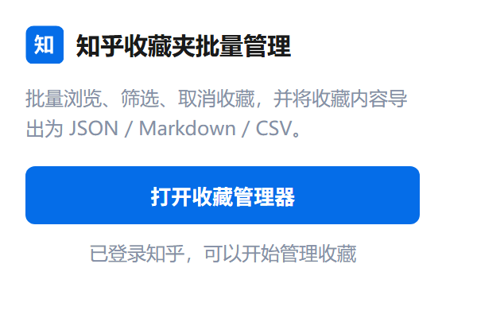

# zhihu-star-manage

**一个适用于知乎收藏内容批量管理的浏览器插件**（Edge / Chrome，Manifest V3）

批量浏览收藏夹、筛选内容、取消收藏、移动收藏夹，并支持多种格式导出。



## 功能

- **收藏夹管理**：
  - 自动读取当前账号的全部收藏夹，显示每个收藏夹的内容数量
  - 新建收藏夹：设置名称、描述、是否公开
  - 编辑收藏夹：修改名称、描述、公开性
  - 删除收藏夹：一键删除并二次确认，防止误删
- **全量加载**：点开收藏夹后自动分页拉取全部收藏（回答 / 文章），支持按标题、作者筛选
- **批量取消收藏**：勾选后一键取消，3 并发限速请求，避免触发知乎限流
- **移动到其他收藏夹**：勾选后选择目标收藏夹，先加入成功再从原收藏夹移除，避免内容丢失
- **多种导出方式**：
  - JSON — 类型、标题、作者、链接
  - Markdown — 生成带链接的清单
  - CSV — 可直接用 Excel 打开
  - 仅标题和链接 (TXT) — 纯文本，方便粘贴到其他工具
  - 正文 Markdown (ZIP) — 抓取每篇回答 / 文章正文转为 Markdown，打包成 ZIP 下载
- **全选 / 反选**，以及点击标题直接跳转原文

## 截图

| 收藏管理主界面 | 新建收藏夹 |
| --- | --- |
|  |  |

| 编辑收藏夹 | 删除确认 |
| --- | --- |
|  |  |

| 移动到其他收藏夹 | 工具栏弹窗 |
| --- | --- |
|  |  |

## 安装

1. 下载本仓库代码（`git clone` 或 Code → Download ZIP 后解压）。
2. 在 Edge 地址栏输入 `edge://extensions/` 并回车（Chrome 为 `chrome://extensions/`）。
3. 打开左下角「开发人员模式」。
4. 点击「加载解压缩的扩展」，选择该插件文件夹。
5. 确保已在浏览器中登录知乎，点击工具栏扩展图标 →「打开收藏管理器」。

## 使用

1. 点击扩展图标，选择「打开收藏管理器」。
2. 在左侧选择收藏夹，插件会自动分页加载全部内容。
3. 用顶部筛选框按标题 / 作者过滤，勾选需要处理的内容（也可全选或反选）。
4. 选择操作：取消收藏、移动到其他收藏夹，或按所需格式导出。

## 权限说明

| 权限 | 用途 |
| --- | --- |
| `cookies` | 读取知乎登录状态与 `_xsrf` 令牌，供写操作携带 |
| `storage` | 保存界面状态 |
| `https://www.zhihu.com/*` | 调用知乎网页端接口读取、修改收藏夹 |
| `https://api.zhihu.com/*` | 收藏接口的备用域名 |

插件只与知乎域名通信，不会向任何第三方发送数据。

## 目录结构

```
zhihu-star-manage/
├── manifest.json      # 扩展清单（MV3）
├── background.js      # 后台 Service Worker，代理知乎 API 并自动携带 Cookie / XSRF
├── popup.html/js      # 工具栏弹窗
├── manager.html/css/js# 收藏管理主页面
├── icons/             # 扩展图标
└── docs/screenshots/  # 文档截图
```

## 说明

- 插件直接调用知乎网页版接口，属于非官方工具。如知乎调整接口，相关功能可能失效，需同步更新请求格式。
- 请合理控制批量操作频率，避免触发账号风控。
- 本项目仅用于个人备份与管理自己的收藏内容。
